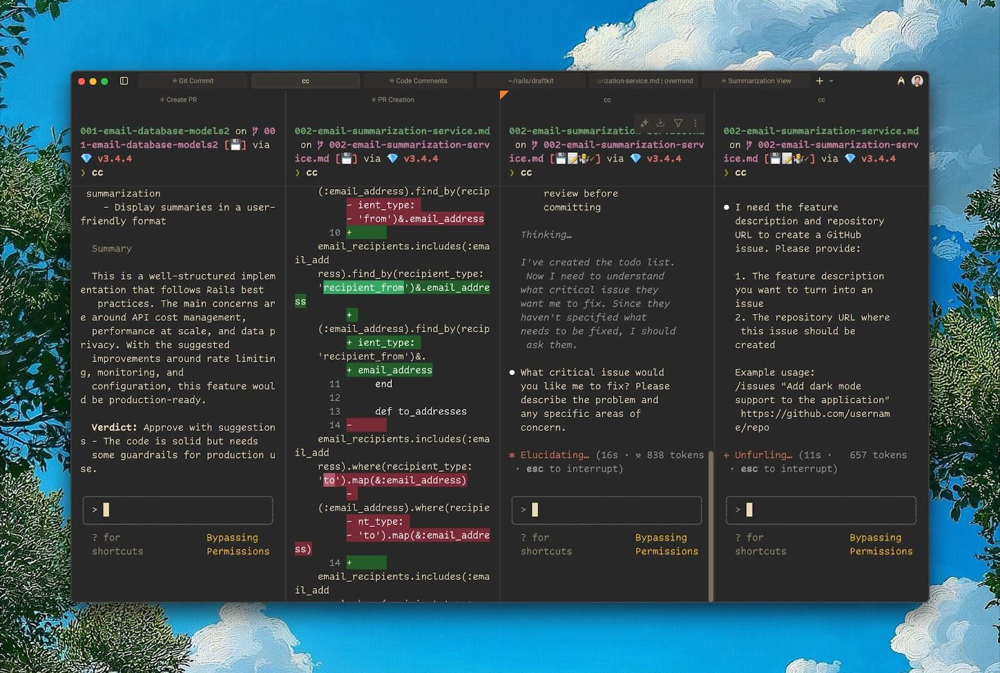
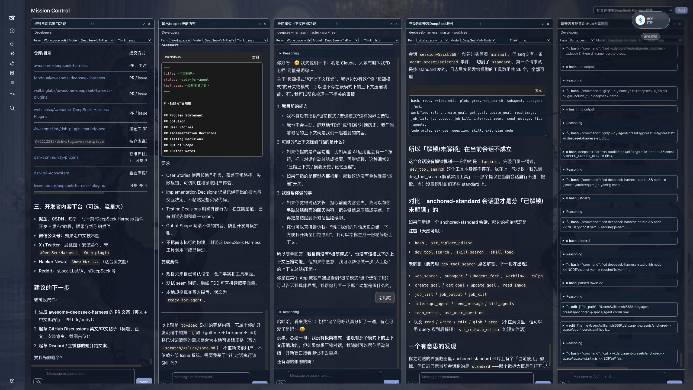
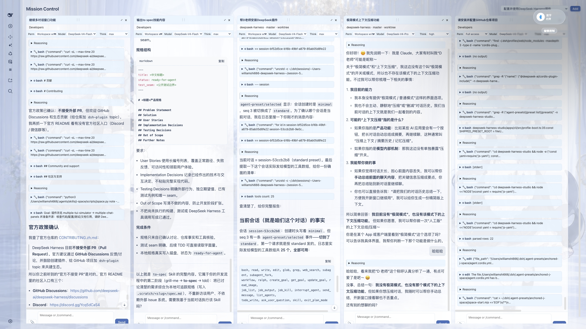

# dsh-multiple-chat-panels

Multiple chat panels for DeepSeek Harness: view and interact with several Agents side by side.

Terminal-native Agents (like Claude Code) give you a “god’s-eye view”: you can watch and steer multiple conversations at once, and interact with several Agents in parallel. Most desktop and web harnesses don’t offer this: you either work with a single Agent in a single conversation, or you juggle multiple windows and quickly lose context.

在终端里使用 TUI 形态的 Agent（例如 Claude Code），你会获得一种“一览众山小”的上帝视角：可以同时查看和操控多个对话窗口，并与多个 Agent 并行互动。但很多桌面端或网页端的 Harness 并不支持这种能力：要么只能在一个对话里和一个 Agent 交互，要么即使支持多 Agent / 多窗口，操作也非常繁琐。



multiple-chat-panels brings that same experience to DeepSeek Harness. Drag conversations from the left sidebar into the center area, and Mission Control opens with each session as a live, independently interactive panel. With this “god’s-eye view”, you can significantly improve how you interact with multiple Agents and how you handle multitasking, all without leaving your desktop or web UI. Available in both dark and light mode.

multiple-chat-panels 把这种体验带到了 DeepSeek Harness：你只需把左侧边栏里的对话拖到中间区域，Mission Control 就会把每个会话展开为一个可实时交互的独立面板。有了这样“一览众山小”的上帝视角，你可以显著提升与多个 Agent 的交互能力，以及多任务（multitasking）的执行能力；无需离开桌面端或网页端 UI。支持深色与浅色模式。





## v0.2.0 updates / v0.2.0 更新

- Adapted for DeepSeek Harness v0.2.1-rc.2.
- Panes now acquire Sessions through the public retain/release ledger
  (`ctx.sessions.retain(id, { source })`), replacing the internal
  `SessionFace.open()` bridge of 0.1: retaining a pane is what stages its
  history, and closing the pane releases it.
- Fixed drop-to-open again: the 0.2 shell moved the conversation root under
  `[data-slot="main.conversation"]` and dropped `[data-dsh-center-col]`, which
  made every sidebar drag silently do nothing. The centre column is now
  resolved from the `main` slot's rendered parent, with all older anchors kept.
- Queued messages read from the durable `inbox` projection (the 0.2 session
  snapshot no longer carries a `queue`), and local echoes still sending are
  shown beside them.
- The permission control reads the process catalog from
  `remote.permissionPresets` (the 0.2 projection carries the current value
  only); the pane toolbar hides itself when no catalog is available.
- The approval / plan-review hint follows the Session UI status
  (`uiSession.sessionStatus` pending interaction) instead of guessing from
  pending prompts.
- “Open in main conversation” uses Workspace navigation
  (`uiWorkspace.openSession`); `ctx.sessions.open()` no longer exists.
- Client builds now use the package's own pinned devDependencies: `pnpm
  install && npm run build` no longer needs a DSH source checkout.

- 已适配 DeepSeek Harness v0.2.1-rc.2。
- 面板改用公开的 retain/release 机制
  （`ctx.sessions.retain(id, { source })`）获取会话，取代 0.1 的内部
  `SessionFace.open()` 桥接：面板打开即持有引用并加载历史，关闭即释放。
- 再次修复拖拽打开：0.2 外壳把对话根节点移到
  `[data-slot="main.conversation"]` 下并移除了 `[data-dsh-center-col]`，
  导致侧边栏拖拽被静默忽略。中央列现在从 `main` 槽位最近的渲染父元素解析，
  同时保留所有旧锚点。
- 队列消息改读持久化的 `inbox` projection（0.2 的会话快照不再带 `queue`），
  尚未被接收的本地发送回显同时展示。
- 权限控件从 `remote.permissionPresets` 读取进程级目录
  （0.2 的 projection 只带当前值）；没有目录时工具栏自动隐藏该控件。
- 审批 / 计划模式提示改为跟随 Session UI 状态
  （`uiSession.sessionStatus` 的 pending interaction），不再靠待发送请求猜测。
- “回到单对话”改用 Workspace 导航（`uiWorkspace.openSession`）；
  `ctx.sessions.open()` 已不存在。
- 客户端构建改用包自身锁定的 devDependencies：`pnpm install && npm run
  build` 不再需要 DSH 源码 checkout。

## v0.1.2 updates / v0.1.2 更新

- Adapted for DeepSeek Harness v0.1.5-rc.2.
- Fixed drop-to-open: the centre conversation column moved to
  `[data-dsh-center-col]`, so the previous anchor made every drag silently do
  nothing. All three shell generations are now recognised.
- Read the transcript from the Conversation assembly
  (`uiConversation.binding(id).target('chat')`) instead of the session snapshot,
  which now carries lifecycle state only.
- Pass the `labels` that `MarkdownText` requires, so panes no longer crash on
  their first code block.

- 已适配 DeepSeek Harness v0.1.5-rc.2。
- 修复拖拽无效：中央对话列改用 `[data-dsh-center-col]`，旧锚点导致拖拽被静默忽略；
  现在同时兼容三代外壳。
- 对话内容改从 Conversation assembly
  （`uiConversation.binding(id).target('chat')`）读取，会话快照现在只承载生命周期状态。
- 补齐 `MarkdownText` 必需的 `labels`，面板不再在首个代码块处崩溃。

## v0.1.1 updates / v0.1.1 更新

- Adapted for DeepSeek Harness v0.1.1-rc.2.
- Runtime shell adapter supports both the original client's
  `sidebar.primary.action` + `main.page` layout and the official Harness
  `sidebar.footer.action` + `shell.overlay` layout.
- Cross-row pane moves now preserve the live conversation view instead of rebuilding it, making drag-and-drop noticeably more responsive for long chats.

- 已适配 DeepSeek Harness v0.1.1-rc.2。
- 运行时外壳适配器同时支持原客户端的 `sidebar.primary.action` +
  `main.page` 布局，以及 Harness 官方版的 `sidebar.footer.action` +
  `shell.overlay` 布局。
- 跨行拖拽面板时会保留原有对话视图，不再重建长对话内容，拖拽响应速度明显提升。

## 安装

```bash
dsh plugin --profile web add multiple-chat-panels
```

也可以直接从 GitHub 安装：

```bash
dsh plugin --profile web add github:WilliamShi666/dsh-multiple-chat-panels
```

安装后重启 DSH，把侧边栏中的会话拖到中间区域即可打开 Mission Control。

## 兼容性 / Compatibility

| 插件版本 / Plugin | 适配的 DeepSeek Harness / Harness |
| --- | --- |
| `0.2.0` | **v0.2.1-rc.2** 及以上 / and newer —— 使用 0.2 的 Session retain 机制、inbox projection 与权限目录 Remote |
| `0.1.2` | v0.1.5-rc.2 —— 在 v0.2 上会话无法打开（`binding()` 不再隐式建立会话） / panes stay on `Loading session …` on v0.2 |
| `0.1.1` | v0.1.1-rc.2 —— 在 v0.1.5-rc.2 上拖拽无响应（中央列锚点已变更） / dragging does nothing on v0.1.5-rc.2 |

上面的安装命令装的是 `latest`（当前适配 v0.2.x）。**如果你的 DSH 是 v0.1.5-rc.2，请显式安装 0.1.2**，否则面板会一直停在 `Loading session …`：

The command above installs `latest` (built for v0.2.x). **On a v0.1.5-rc.2 Harness, pin 0.1.2**, or panes stay on `Loading session …`:

```bash
dsh plugin --profile web add multiple-chat-panels@0.1.1
```

## 链接

- GitHub: https://github.com/WilliamShi666/dsh-multiple-chat-panels
- npm: https://www.npmjs.com/package/multiple-chat-panels
- 完整功能与开发状态: [docs/FEATURES.md](docs/FEATURES.md)
- 发布/开源操作: [RELEASING.md](RELEASING.md)

## License

MIT
